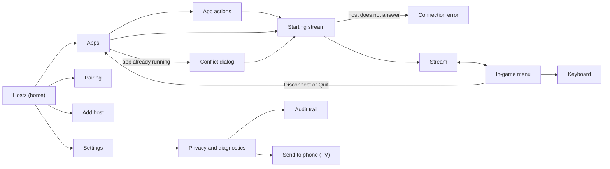

# Phase 2 UX proposal

## Status

Approved by the owner on 2026-10-15, in Sprint 3. All eight decisions take the
first (recommended) option. The choices are recorded in
[ADR 0052](../adr/0052-structure-the-phase-2-ui.md).

Sprint 4 implemented the Library screens in Compose: Hosts with Continue, Add
host, Pairing, Apps and App actions. They are the launcher now, and they replace
the 12.2 host list and app grid.

Sprint 5 implemented the stream screens (Starting stream, Conflict dialog and
Connection error), the in-game menu, the Borealis keyboard and the Compact and
Detailed performance overlay.

Sprint 6 implemented Settings, Privacy and diagnostics, the Audit trail viewer
and Send to phone in Compose. They replace the upstream stream settings and
the interim Borealis settings screen, which are deleted (ADR 0055).

Sprint 7 refined the visuals: the icons, and the sizes of dialogs and panels. It
added the Pointer speed row to the in-game menu, and a window 600 dp or wider
became a handheld while a game controller is connected.

Sprint 8 was a tidy-up of the code. On screen, the four phone title bars (Apps,
Audit, Settings and Privacy) now share one phone bar and one back button, and the
Help button is gone.

Sprint 9 polished the screens and the handheld. Quit says what it does, for
Desktop and for a game. The host Details dialog lists plain lines. Every phone
bar has the same 4dp gap, and handheld host cards follow their content. The
keyboard key for the digits reads "Fn 123". Settings changes between groups at
once on a TV and a handheld, and it has a new Appearance group. An animated
background sits behind the Library and Settings screens
([ADR 0056](../adr/0056-add-an-animated-background-and-the-appearance-group.md)).

Sprint 10 added glass and the accessibility work
([ADR 0057](../adr/0057-glass-surfaces-and-the-accessibility-settings.md)). Cards,
panels and the rail show the background through a tint and a blur, text that
stands on the background has a soft halo, and a dialog or a sheet blurs the
window behind it. Settings has 11 groups: Accessibility is new (Reduce motion,
Transparency, Thicker focus outline, Text size, High contrast and a Colour-blind
palette), and Appearance has Glass tint and Glass blur. The stream reads that
look when it starts. On a phone every Settings group is a collapsible section;
on a TV and a handheld OK enters the pane of a group. The rail ends in a footer
with the logo, the name and the version, and Back from Apps returns to the card
that was opened. Snackbars are as wide as their text, a Quit in the stream
leaves "App quit." in the Library, and an About link opens in a task of its own.
The screens work with TalkBack, and touch targets are 48dp on a phone and a
handheld ([accessibility](accessibility.md)).

The prototype predates the Sprint 10 look: it has no glass, halo, rail footer or
Accessibility settings. It shows the approved Phase 2 design, not the built
screens.

The screens below are the approved design; where the built screen differs, the
section says so. Screenshots use
Roborazzi ([ADR 0034](../adr/0034-screenshot-testing-with-roborazzi.md)), and
the colours and type come from the token pipeline
([ADR 0044](../adr/0044-design-tokens-pipeline.md)).

Sources of this document:

- [prototype.html](prototype.html): the clickable prototype. Open it in a
  browser; see [How to open the prototype](#how-to-open-the-prototype).
- [design/tokens.json](../../design/tokens.json): the approved tokens, dark only.
- [captures/](captures/): screen captures of the prototype.

## Scope and out of scope

In scope for Phase 2:

- the screens and states in the sections below, for phones, TVs and
  handhelds;
- the input rules and the in-game menu;
- the dark theme, with the tokens above.

Out of scope:

- REST features, which arrive in Phase 3. The prototype shows them only as
  disabled items or placeholders; see [Phase 3 extension points](#phase-3-extension-points).
- PyroWave, which arrives in Phase 4 ([host contract](../host-contract/pyrowave.md)).
- A light theme in 1.0. The prototype's App theme switch shows Light for
  review only ([D1](#decisions)).

## Input modes and rules

The same navigation map serves the phone (touch), the TV (D-pad and remote)
and the handheld (gamepad). The rules are the same in every mode:

- Focus: a 3dp accent-soft outline with a 2dp offset, on TV and gamepad. A
  focused cover tile scales to 1.04, unless Reduce motion removes animations.
  With Thicker focus outline, and with High contrast, the outline is 5dp and in
  ink ([ADR 0053](../adr/0053-material-3-with-borealis-focus-on-tv.md)).
- Back: one step up the [navigation map](#navigation-map). During a stream,
  Back opens the in-game menu instead of leaving the stream.
- Options (the actions of an item, such as an app or a host):
  - long-press on touch; the prototype shows a ⋯ button that stands for the
    long-press;
  - hold OK on a TV (Shift + Enter in the prototype);
  - X on a gamepad.
- Gamepad menu chord: hold Select + Start to open the in-game menu. The
  prototype uses Q on a keyboard to stand for the chord. The chord arms only from
  a clean start: Start and Select left held after the quit combo (Start, Select,
  LB and RB) do not open the menu.
- On a stream, every other button goes to the PC. The prototype shows a toast
  for the keys that are not Back or the chord.

## Navigation map

The map is the same in all three input modes. Back always moves one step up
this map.

## Screens

### Index

| Screen | Group | Captures |
| --- | --- | --- |
| Hosts | Library | hosts-phone, hosts-tv |
| Add host | Library | none |
| Pairing | Library | pairing-phone |
| Apps | Library | apps-tv |
| App actions | Library | none |
| Starting stream | Starting | starting-phone |
| Conflict dialog | Starting | conflict-phone |
| Connection error | Starting | error-tv |
| Stream | Streaming | stream-phone |
| In-game menu | Streaming | menu-handheld |
| Keyboard | Streaming | keyboard-tv |
| Settings | Settings | settings-tv |
| Privacy and diagnostics | Settings | none |
| Audit trail | Settings | none |
| Send to phone | Settings | send-to-phone-tv |

Each capture shows the first state of its screen, with these exceptions:
`starting-phone` shows the "Host busy (retry)" state at its second step,
`error-tv` shows "Host busy", and `stream-phone` shows the Compact overlay.
On a TV or handheld the focus outline marks the element that has the focus
when the screen opens.

### Hosts

Purpose: the home screen. It shows the session to continue first, then every
known or discovered host with its state and the one action that state allows.

States:

- With hosts (default).
- Searching: no host found yet. The empty screen explains the next step
  ([D8](#decisions)).
- Loading: before the first host report arrives, the screen shows a progress
  indicator and nothing can be focused.

- Each host card is one focus stop, with no action button. Its action depends
  on the host: open when it is online and paired, pair when it is not paired,
  and wake when it is offline. The click action is named for screen readers.
- Touch: a tap on a card runs its action.
- D-pad (TV): left rail plus a host grid. Focus starts on Continue. OK runs the
  card's action; hold OK, or a long press, opens the host options (details,
  wake, forget). When Back brings the screen back from Apps, the focus goes to
  the card that was opened, found by its host (a Continue card too), and to the
  first card when that host is gone. The rail ends in a footer with the
  Borealis mark, the name and the version. It takes no focus, it hides when the
  rail is short, and a screen reader reads it as one sentence.
- Gamepad: as the TV. A runs the card's action and X shows the options. Menu
  also shows the options. B does nothing at the top level.
- Card height: on a TV a card is at least 176dp high, so the cards of a grid
  match. On a handheld, which is short, and on a phone, a card is as high as its
  content, and the cards of a row are as high as the tallest of them (UAT of
  2026-10-22).
- Details, in the host options, lists what the client knows of the host in plain
  lines: name, status, address, other addresses, paired, MAC address (for wake)
  and the running app. An unknown value leaves its line out, except the status,
  which reads "Checking…". An address shows its port only when it is not the
  default HTTP port. The UUID is not shown. The host capabilities follow after a
  blank line, with the HTTP and HTTPS ports.

Changes from 12.2: 12.2 hides pairing, wake and details in a long-press
context menu, and has no Continue row.

Decisions: [D2](#decisions), [D8](#decisions).

### Add host

Purpose: manual add for hosts that discovery does not find, for example
across VLANs.

States: none.

- Touch: one field; the system keyboard opens at once.
- D-pad (TV): the system TV keyboard opens on OK. The default port needs no
  input.
- Gamepad: as the TV.

Changes from 12.2: the same flow, restyled. No port hint exists today.

Decisions: none.

The address field takes an IP address or a host name. The port is added only
when the LuminalShine port was changed from the default 47989
([host contract, section 2](../host-contract/luminalshine.md)).

### Pairing

Purpose: the PIN is entered on the host, in the LuminalShine Web UI. The
screen says where, keeps the PIN large enough to read from a couch, and covers
the restart and expiry cases that Borealis already handles.

States:

- Waiting for PIN (default).
- New PIN after restart: the host cleared an unfinished attempt and a new PIN
  is shown.
- Paired: the screen closes when the host accepts the PIN.
- Expired: the PIN expired; the user starts again.

- Touch: Cancel only. The screen closes by itself when the host accepts the
  PIN.
- D-pad (TV): the same, with the PIN digits at TV size. Back cancels.
- Gamepad: as the TV.

Changes from 12.2: 12.2 shows the PIN in a small dialog. The Borealis restart
and host-error messages arrive as toasts.

Decisions: none.

The device name must not contain `xbox` or `webos`. The host then holds each
stream start for up to 8 s ([host contract, section 10.2](../host-contract/luminalshine.md)).
The prototype shows this as a step in the pairing text.

### Apps

Purpose: the apps of one host. The running app is marked and comes first.
Covers are placeholders until the host REST API serves covers by UUID
(Phase 3).

States:

- Desktop running (the first app is marked as running).
- Nothing running.

- Touch: tap starts or resumes the app. The ⋯ button (or long-press) opens the
  app actions.
- D-pad (TV): five columns. OK starts or resumes; hold OK opens the actions.
- Gamepad: four columns. A starts, X opens the actions, B goes back.

Changes from 12.2: the same grid and context menu, restyled, with the running
state visible without opening a menu.

Decisions: [D6](#decisions).

### App actions

Purpose: every action that an app allows in its current state, with the
consequence written under each label.

States:

- Running app: Resume, Quit, Details.
- Other app running: Quit the running app and start this one, Details, Hide
  from this list.

- Touch: bottom sheet.
- D-pad (TV): centered dialog; focus starts on the first action.
- Gamepad: as the TV.

Changes from 12.2: 12.2 shows a context menu with Resume Session, Quit
Session, Quit Current Game and Start.

Decisions: [D6](#decisions).

The consequence of Quit and of Quit and start has one sentence on each line:

- Quit, when the app is Desktop (the app titled "Desktop", ignoring case): "Ends
  the stream." and "The display and controls go back to the PC."
- Quit, for any other app: "Closes `<app>` on the PC." and "Unsaved progress in it
  is lost."
- Quit and start, when Desktop runs: "Ends the stream first." and "Nothing is
  lost."
- Quit and start, when another app runs: "Closes `<app>` on the PC first." and
  "Unsaved progress in it is lost."

The confirmation of a quit has only "Quit `<app>`?" as its title and the
consequence as its body.

### Starting stream

Purpose: each stage of starting a stream. The stages include the per-client
virtual display that the host builds for this device and the retries that
Borealis already performs.

States:

- Progress (default): the stages are connecting, starting the app, preparing
  the display, and waiting for the first frame.
- Host busy (retry): another device is starting a stream on this host. The
  screen says that Borealis retries and how many retries are left.

- Touch: Cancel stays available at every step.
- D-pad (TV): Back cancels.
- Gamepad: B cancels.

Changes from 12.2: 12.2 shows one spinner dialog. Sprint 2 added the retry
text to it.

Decisions: none.

The host builds the display for a per-client launch in about 14 s on the
Sprint 2 test host ([host contract, section 7.3](../host-contract/luminalshine.md)).
The screen copy says "up to 15 s" to leave a margin over the measured time.

### Conflict dialog

Purpose: another device started an app on this host. Join and Quit and
relaunch are explicit. Cancel has the focus, so a stray OK changes nothing.

States:

- Same app: the running app is the one the user chose.
- Other app: the running app is different. The dialog offers Quit and start.

- Touch: dialog.
- D-pad (TV): focus starts on Cancel.
- Gamepad: focus starts on Cancel; B cancels.

Changes from 12.2: the Sprint 2 dialog, restyled.

Decisions: none.

The dialog warns what quitting costs. For Desktop it says "Quitting ends the
stream on the other device." For any other app it says "Quitting ends the stream
on the other device and closes the app." and, on a second line, "Unsaved progress
in it is lost." See [UC-003](../use-cases/0003-join-or-replace-a-running-app.md).

The capture is of the prototype and shows the wording from before Sprint 9.

### Connection error

Purpose: errors say what happened and what the host was doing, and offer the
next step. The raw code stays visible for support. The raw code is always the
real code of the failed start or stream (for example `Error -1 · RTSP
handshake`); the prototype's placeholder "Error 0" is not used.

States:

- Host busy: the host did not answer in time. It is probably building a
  display for another device.
- Host offline: the PC is off, asleep, or on another network. The next step
  is Wake PC.
- Certificate changed: the host identity changed since pairing. The next step
  is to pair again. The event is recorded in the audit trail.

- Touch: Try again, the state-specific action, and Diagnostics.
- D-pad (TV): focus starts on Try again.
- Gamepad: as the TV.

Changes from 12.2: 12.2 shows a generic "Connection error" dialog with a code.

Decisions: none.

The Host busy detail line names the attempt count, not a duration: the
Sprint 3 retry makes up to 3 attempts within about 25 s
([host contract, section 7.3](../host-contract/luminalshine.md)).

### Stream

Purpose: the picture and, when the user turns it on, the overlay. Nothing else.
The first time, a hint says how to open the menu on this device.

States: none.

- Touch: pull the top handle down, or press Back, to open the menu. A
  three-finger tap opens the keyboard, as in 12.2.
- D-pad (TV): Back opens the menu instead of leaving the stream.
- Gamepad: hold Select + Start for the menu. Every other button goes to the PC.

Changes from 12.2: Back leaves the stream at once. There is no menu.

Decisions: [D3](#decisions), [D4](#decisions), [D5](#decisions).

### In-game menu

Purpose: one menu for every device. Session actions are at the bottom and are
separated by intent: Disconnect leaves the app running, Quit ends it.

States: none. The menu items are listed in [In-game menu items](#in-game-menu-items).

- Touch: side panel over the stream; tap outside to close.
- D-pad (TV): focus starts on Back to stream. Back closes the menu.
- Gamepad: B closes the menu.

Changes from 12.2: not in 12.2. Artemis has a dialog-style menu with similar
items.

Decisions: [D3](#decisions), [D5](#decisions), [D6](#decisions).

### Keyboard

Purpose: a full keyboard with modifiers that latch, and one row of Windows
shortcuts that are awkward to type. See [In-stream keyboard](#in-stream-keyboard).

States: none.

- Touch: docked at the bottom; the stream stays visible above it.
- D-pad (TV): the D-pad moves across the keys; OK types.
- Gamepad: the D-pad moves, A types, B closes, and Y is Backspace.

Changes from 12.2: 12.2 opens the Android soft keyboard. Android 16 keyboard
capture stays for physical keyboards.

The System keyboard key opens the Android keyboard for free text, which is
sent to the PC as UTF-8. While the Android keyboard is open, a gamepad's D-pad,
Enter and Back go to it, not to the PC.

Decisions: none.

### Settings

Purpose: global settings in groups (Stream, Video, Input, Gamepad, On-screen
controls, Audio, Advanced, Appearance, Accessibility and About), plus Privacy and
diagnostics, which is a link row on a phone and a group on TV and handheld. On a
TV and a handheld the groups are in this order: Stream, Video, Input, Gamepad,
On-screen controls, Audio, Advanced, Appearance, Accessibility, Privacy and
diagnostics, and About. That is 11 groups, and 10 on a device with no
touchscreen, such as the Google TV Streamer, which has no On-screen controls.
Each row shows its current value. Per-host overrides come later.

States: none.

- Touch: one list. Every group is a collapsible section. All start collapsed,
  several can be open, and the open ones survive a rotation and a trip to
  Privacy and diagnostics. About is a section, and Privacy and diagnostics stays
  a row that opens its own screen.
- D-pad (TV): two panes. Categories are on the left and items on the right.
- Gamepad: as the TV.

Changes from 12.2: one long preference screen, plus a separate Borealis
screen.

Decisions: [D7](#decisions).

The two panes of a TV and a handheld work like stacked tabs:

- Every group has a pane that is built once and stacked with the others. Moving
  focus to another group only changes which pane is visible, in the same frame
  and with no wait.
- The selected group is built first and the others follow, one per frame,
  nearest first. Privacy and diagnostics is built only while it is selected.
- A pane that is not shown takes no focus, touch or accessibility. A group opens
  at its top.
- Opening Settings from the rail puts focus on the selected group. Right, or OK
  (Enter, the numpad Enter and gamepad A), enters the rows of the group. A touch
  tap only selects the group. Left returns to the group, and from the group to
  the rail.
- On a TV the 11 groups fit a 540dp window without scrolling (10 on the
  Streamer). On a handheld the list scrolls, because its entries are 48dp.

The groups and their rows are listed in [Settings groups](#settings-groups).

### Privacy and diagnostics

Purpose: everything about logs and diagnostics in one place, including the
audit trail viewer that the Phase 2 UI adds.

States: none.

- Touch: Export shares the bundle.
- D-pad (TV): Export saves the bundle and offers Send to phone.
- Gamepad: on a TV, as the D-pad. A handheld exports like a phone: Export shares
  the bundle. Send to phone is TV only ([UC-006](../use-cases/0006-send-diagnostics-from-a-tv-to-a-phone.md)).
  This corrects the earlier "as the TV" for handhelds; the prototype's split is
  older than that decision.

Changes from 12.2: a Sprint 2 interim screen.

Decisions: none.

Rows: Verbose logging, Mask addresses in logs and diagnostics, export diagnostic
bundle, audit trail, and erase audit trail. The erase row says that it cannot
be undone. See [privacy and logging](../policies/privacy-and-logging.md).

### Audit trail

Purpose: security-relevant events, newest first, in plain words with the event
code for support.

States: none.

- Touch: scrolls; tap an entry for its detail.
- D-pad (TV): D-pad scrolls entry by entry.
- Gamepad: as the TV.

Changes from 12.2: only inside the exported bundle (Sprint 2).

Decisions: none.

The event codes are listed in [Audit event names](#audit-event-names). The
retention is the newest 2,000 entries or 90 days, whichever is smaller
([privacy and logging](../policies/privacy-and-logging.md#audit-trail)).

### Send to phone

Purpose: the Sprint 3 transfer. It is a one-download link on the local
network, shown as a QR code, and it closes after the download or after
5 minutes.

States:

- Waiting: the link is open and the countdown runs.
- Downloaded: the link is closed.
- Expired: the link expired; the user opens Send to phone again.
- No local network: a phone cannot reach the TV. The dialog shows the adb
  command instead.

- Touch: not offered on phones. Phones share instead.
- D-pad (TV): Close has the focus. Closing the dialog stops the link.
- Gamepad: as the TV.

Changes from 12.2: adb pull only.

Decisions: none.

The phone and the TV must be on the same network. The link works for one
download. See [UC-006](../use-cases/0006-send-diagnostics-from-a-tv-to-a-phone.md).

## In-stream details

### In-game menu items

The menu lists these items, in this order. Items that the prototype shows as
disabled are marked.

1. Back to stream. Closes the menu.
2. Keyboard. Opens the [keyboard](#keyboard).
3. Send keys. Expands a row of chips: Alt+Tab, Win+Tab, Win, Ctrl+Shift+Esc,
   Alt+F4, Win+D, Win+G, Esc, Win+Alt+B.
4. Touch (phone) or Gamepad mouse (TV and handheld). On a phone the choices
   are Trackpad, Direct and Off. On a TV or handheld the choices are On and
   Off.
5. Pointer speed (TV and handheld). Shown under Gamepad mouse, and only while
   the gamepad mouse is on. The choices are Slow, Normal and Fast, for this
   session. See [UC-004](../use-cases/0004-use-the-in-game-menu.md).
6. Overlay: Off, Compact or Detailed. The approved default is Off
   ([D5](#decisions)).
7. Refresh the picture. Asks the host for a keyframe when the image is
   smeared.
8. Session info. Expands to the video, codec, decoder, host and network
   figures, and the bitrate against its limit.
9. Display for next launch. Disabled: it needs the host API (Phase 3).
10. Disconnect. Describes the consequence: the app keeps running on the PC.
11. Quit and the app name. Says what Quit does, one sentence on each line. For
    Desktop: "Ends the stream." and "The display and controls go back to the PC."
    For any other app: "Closes `<app>` on the PC." and "Unsaved progress in it is
    lost." A confirmation follows, titled "Quit `<app>`?", with the same lines as
    its body. This row is shown in the danger style.

### In-stream keyboard

- A shortcut row: Alt+Tab, Win+Tab, Win, Ctrl+Shift+Esc, Alt+F4, Win+D, Esc,
  F11 and Close.
- Three letter rows. The first is Q to P. The second is A to L and ends with
  Backspace. The third starts with Shift, has Z to M, and ends with Enter.
- A bottom row: Ctrl, Win, Alt, Space, Tab and Fn 123.
- Fn 123 switches the three letter rows to the Fn layer, and Fn 123 again switches
  back. The key says "123" so that the digits are found. The layer has three
  rows: the digits 1 to 0; F1 to F10; and the four arrows with Home, End, PgUp,
  PgDn and Del. The bottom row stays, and Fn 123 shows as on while the layer is
  open.
- Ctrl, Alt, Win and Shift latch. The next typed key is sent with them, and
  the latch is cleared. A latch stays on across the switch to the Fn layer.

### Overlay contents

Compact (one line of four figures):

- frames per second;
- host processing time in ms;
- network time in ms;
- the codec, for example HEVC 10-bit HDR.

Detailed:

- resolution, frame rate (cap), codec and HDR format;
- the decoder name;
- host processing time as minimum, average and maximum in ms;
- network time in ms with the jitter, the loss in percent and the bitrate in
  Mbps;
- decode time in ms.

The render queue time is not shown: it is not measured yet.

The prototype's figures are examples. The overlay is off by default
([D5](#decisions)).

### Settings groups

| Group | Setting | Control | Rule |
| --- | --- | --- | --- |
| Stream | Resolution | list | Entries filtered by the display and the decoder. The native resolution is offered, with a warning that the PC must support it. Changing it returns Bitrate to automatic. |
| | Frame rate | list | 120 is hidden when the display is below 118 Hz, and 90 when it is below 88 Hz, unless Unlock all frame rates is on. Changing it returns Bitrate to automatic. |
| | Bitrate | slider, 0.5–150 Mbps | "Automatic" shows the value computed from the resolution and frame rate. |
| | Frame pacing | list | |
| Video | Codec | list | Automatic, AV1, HEVC, H.264. |
| | HDR | switch | Hidden without an HDR10 display. |
| | Full range | switch | |
| | Performance overlay | Off, Compact, Detailed | |
| | Stretch video | switch | |
| Input | Touch | Trackpad or Direct | |
| | Mouse back and forward buttons | switch | |
| | Remote desktop mouse mode | switch | Hidden on NVIDIA Shield. |
| | Gamepad mouse | switch | |
| | Analog scrolling | list | Disabled while Gamepad mouse is off. |
| | Gamepad mouse speed | slider, 10–200 % | Disabled while Gamepad mouse is off. |
| | Deadzone | slider, 0–20 % | |
| Gamepad | Multiple controllers | switch | |
| | USB driver for Xbox controllers | switch | Hidden without USB host support. Off also stops the USB attach dialog. |
| | Use the USB driver for all controllers | switch | Hidden without USB host. Disabled while the driver is off. |
| | Flip face buttons | switch | |
| | Touchpad as mouse | switch | |
| | Motion sensors | switch | Hidden below Android 12. |
| | Motion fallback | switch | Hidden without an accelerometer and a gyroscope. |
| | Vibrate fallback | switch | Hidden without a vibrator. |
| | Vibration strength | slider, 0–200 % | Hidden without amplitude control. Disabled while Vibrate fallback is off. |
| On-screen controls (hidden without a touchscreen) | Show on-screen controls | switch | |
| | Vibrate | switch | Disabled while the controls are hidden. Hidden without a vibrator. |
| | Only L3 and R3 | switch | Disabled while the controls are hidden. |
| | Guide button | switch | Disabled while the controls are hidden. |
| | Opacity | slider, 0–100 % | Disabled while the controls are hidden. |
| | Reset layout | action | Asks first ("Cannot be undone"). |
| Audio | Channels | 2.0, 5.1, 7.1 | |
| | Play audio on the PC | switch | |
| | Audio effects | switch | |
| Advanced | Optimise game settings | switch | |
| | Unlock all frame rates | switch | The Frame rate list updates at once. |
| | Reduce refresh rate | switch | |
| | Disable connection warnings | switch | |
| | Latency summary after a stream | switch | |
| | Picture-in-picture | switch | Hidden without picture-in-picture, and on Fire OS. |
| Appearance | Background | list | Aurora curtains (the default), Soft glow, Northern lights, Light mist, Flowing light, Starfield or Off. Stored as `borealis_background`. The Library follows the choice at once. |
| | Glass tint | list | 30, 40 (the default), 50, 60, 70 or 85 %. Sets the Standard level of Transparency. Disabled while High contrast is on, and while Transparency is Reduced or Off. |
| | Glass blur | list | 8 (the default), 16, 24, 32 or 48 dp. Sets the Standard level of Transparency. Disabled like Glass tint. |
| Accessibility | Reduce motion | list | Follow system (the default), On or Off. Follow system tracks the animation scale of the system while the app runs. |
| | Transparency | list | Standard (the default), Reduced or Off. Reduced and Off override Glass tint and Glass blur. Disabled while High contrast is on. |
| | Thicker focus outline | switch | Off by default. A 5dp outline in ink. Disabled while High contrast is on, which draws it. |
| | Text size | list | 100 % (the default), 115 or 130 %, times the system font scale. |
| | High contrast | switch | Off by default. Solid panels, text at 7:1 or more, opaque borders, a dimmed background and the thicker outline. |
| | Colour-blind palette | list | Off (the default), Red-green or Blue-yellow. Changes the status colours. |
| Privacy and diagnostics | Verbose logging, Mask addresses in logs and diagnostics, Export diagnostic bundle, Audit trail, Erase audit trail | | On a phone it is a link row to its own screen; on TV and handheld it is a group. |
| About | Borealis version and commit, Source code, Open-source licences, Privacy policy | | The Version row has no chevron and opens nothing. A link opens in a task of its own, so Back returns to the app. A link with no browser shows the address in a dialog. |

The extra groups (Gamepad, On-screen controls and Advanced) and the dropped
settings (Language and Small icon mode) come from
[ADR 0055](../adr/0055-settings-storage-and-the-phase-2-settings-screen.md). The
Appearance group comes from [ADR 0056](../adr/0056-add-an-animated-background-and-the-appearance-group.md),
and its glass rows and the Accessibility group come from
[ADR 0057](../adr/0057-glass-surfaces-and-the-accessibility-settings.md).

The prototype fills the rows with example values, not defaults. Phase 2 keeps
the current defaults: 1280 x 720, 60 fps, automatic bitrate, lowest-latency
frame pacing, automatic codec, HDR off, full range off, overlay off,
trackpad on, stereo audio, audio on the PC off, Verbose logging off, Mask
addresses in logs and diagnostics off, the background Aurora curtains, a glass
tint of 40 % and a blur of 8dp, and the Accessibility defaults in the table.

### Audit event names

The audit trail uses these event names. The privacy policy lists the events
and their fields ([privacy and logging](../policies/privacy-and-logging.md#audit-trail)).

- Pairing: PAIRING_START, PAIRING_SUCCESS, PAIRING_FAILURE, PAIRING_RESTART.
- Unpairing: UNPAIR_CONFIRMED, UNPAIR_NOT_CONFIRMED.
- Host identity and TLS: CERTIFICATE_CHANGED, TLS_FAILURE.
- Launch: LAUNCH_ATTEMPT, LAUNCH_RETRY, LAUNCH_CONFLICT.
- Session: SESSION_START, SESSION_END.

The prototype shows these example rows, with example hosts:

| Time | Entry | Event code |
| --- | --- | --- |
| 20:42 | Stream ended | SESSION_END |
| 20:34 | Stream started | SESSION_START |
| 20:33 | Host asked to retry | LAUNCH_RETRY |
| 20:33 | App started | LAUNCH_ATTEMPT |
| 18:02 | Paired | PAIRING_SUCCESS |
| 18:01 | Pairing restarted | PAIRING_RESTART |
| 18:00 | Pairing started | PAIRING_START |
| Mon | Host certificate changed | CERTIFICATE_CHANGED |

No entry records a PIN, a token or a key ([privacy and logging](../policies/privacy-and-logging.md)).

## Decisions

ADR [0052](../adr/0052-structure-the-phase-2-ui.md) records the eight choices.
The owner approved the first option of each decision on 2026-10-15.

| ID | Decision | Chosen option |
| --- | --- | --- |
| D1 | Light theme | Dark only for 1.0 |
| D2 | Home | Hosts, with a Continue row on top |
| D3 | Opening the in-game menu | Back opens the menu; top handle on touch; Select + Start held on gamepads |
| D4 | Default touch mode | Trackpad (relative), as today |
| D5 | Performance overlay | Off, one tap away in the menu (Compact or Detailed) |
| D6 | Leaving a session | "Disconnect" and "`Quit <app>`", each with a one-line consequence |
| D7 | Settings scope | Global now; per-host overrides later |
| D8 | First run | No onboarding; the empty Hosts screen explains the next step |

The options that were not chosen, with their pros and cons, are in ADR 0052.

Sprint 9 refined D6 by an owner decision: the consequence of Quit has two lines,
one sentence on each, and says what Quit does for Desktop and for another app
(see [In-game menu items](#in-game-menu-items)).

## Visual language

### Tokens

The tokens come from the LuminalShine Mission Control web UI. The gold accent
family is replaced by violet. [design/tokens.json](../../design/tokens.json)
is the source. The dark palette:

| Token | Value | Use |
| --- | --- | --- |
| page | #0E1013 | Screen background |
| chrome | #0B0D10 | Navigation rail and bars |
| surface | #14171B | Cards, sheets, dialogs, side panels |
| surface-raised | #1A1E24 | Keys, popovers, elements on a surface |
| ink | #E8EAED | Primary text |
| ink-2 | #C3C7CC | Secondary text |
| ink-3 | #8B9096 | Tertiary text and metadata |
| ink-4 | #7A8087 | Hints and kickers |
| accent | #A78BFA | Primary actions, links, selection |
| accent-soft | #C4B5FD | Focus outline on TV and gamepad |
| accent-strong | #7C3AED | Borders and fills that carry no text |
| on-accent | #160B2E | Text and icons on accent fills |
| success-ink | #7BD389 | Success text |
| warning-ink | #FFC857 | Warning text |
| danger-ink | #FF8A80 | Danger text and destructive actions |
| offline | #686E75 | Status ring of an offline or unknown host |

Status colours (success #4CAF50, warning #FFA726, danger #F44336) are reserved
for state. They are never decorative. A status is never told by colour alone:
the dot is a filled circle for online, a filled triangle for attention and a
hollow ring for offline and unknown.

The file has two more groups of colours. `high-contrast` replaces the text, the
accent and the border roles while High contrast is on: text at 7:1 or more
(`ink` #FFFFFF, `ink-2` #E8EAED, `ink-3` #D0D3D7, `ink-4` #BEC1C4, and the
`accent` #C8B7FC), opaque borders (`line` #80868D, `line-strong` #9CA2A8), and a
dim of 0.85 over the background. `colour-vision` holds the status colours of the
Red-green and Blue-yellow palettes. [Accessibility](accessibility.md) lists
both.

### Changes from Mission Control

- `ink-4` is #7A8087 instead of #6F757C. The old value gives 4.09:1 on page
  and 3.86:1 on surface (computed), which fails 4.5:1 for hint text. The new
  value gives 4.78:1 on page and 4.51:1 on surface.
- On `surface-raised`, use `ink-3`, not `ink-4`.
- The offline colour is #686E75 instead of #4B5158. The old value gave 2.2:1 on
  surface; the new one gives 3.7:1 on page, 3.5:1 on surface and 3.25:1 on
  surface-raised, which a non-text indicator needs (WCAG 1.4.11).

### Contrast

Dark palette, WCAG 2.x, computed:

| Pair | Ratio | Use |
| --- | --- | --- |
| ink on page | 15.81 | Body text |
| ink-2 on surface | 10.58 | Secondary text |
| ink-3 on surface | 5.59 | Tertiary text |
| ink-4 on page | 4.78 | Hints |
| ink-4 on surface | 4.51 | Hints |
| accent on page | 7.00 | Accent text and links |
| accent on surface | 6.61 | Accent text on surfaces |
| on-accent on accent | 6.88 | Text on accent fills |
| accent-soft on page | 10.32 | Focus outline and accent text on dark overlays |
| accent-strong on page | 3.34 | Borders and fills without text only |
| success-ink on surface | 9.86 | Success text |
| warning-ink on surface | 11.69 | Warning text |
| danger-ink on surface | 7.88 | Danger text |

These ratios are for the plain page and the surfaces. Over the animated
background and the glass panels, the contrast is measured over real frames and
the numbers are in [accessibility](accessibility.md); the decisions are in
[ADR 0057](../adr/0057-glass-surfaces-and-the-accessibility-settings.md). The
target is WCAG 2.2 AA on every screen, and 7:1 for text with High contrast on.
See also [Background](#background).

### Type

- Typefaces: IBM Plex Sans for the UI; IBM Plex Mono for data, codes,
  addresses and PIN digits.
- Phone scale: title 18sp semibold; body 14sp; secondary 12.5sp; kicker 11sp,
  uppercase, letter spacing 0.07em; PIN 34sp monospace.
- TV scale: title 24sp semibold; body 15sp; navigation rail 14.5sp medium. No
  text is smaller than 12sp on a TV.

### Radii and spacing

- Radii: card 12dp; button 8dp; input 8dp; cover 10dp; chip 7dp; bottom sheet
  18dp at the top corners; pill 999dp.
- Spacing: a 4dp base unit. Screen gutter 16dp on phones and 34dp on TVs.
  Card padding 14dp on phones and 18dp on TVs.
- A phone bar has 4dp at each side, so the back arrow lines up with the gutter,
  and 4dp between the arrow, the title and the actions, as a Material 3 top app
  bar leaves.

### Background

One animated background sits behind the Library and Settings screens: Hosts, Add
host, Pairing, Apps, Settings, Privacy and diagnostics and the Audit trail. The
screens have no page colour of their own. It is never shown in a stream.
[ADR 0056](../adr/0056-add-an-animated-background-and-the-appearance-group.md) records the decision.

- Styles: Aurora curtains (the default) and Soft glow are drawn in Compose.
  Northern lights, Light mist, Flowing light and Starfield are looping clips. Off
  is the plain page colour. The user chooses in Settings, Appearance, Background.
- A navigation removes the old screen at once and fades the new one in over
  150ms.
- Reduce motion (the Accessibility setting, which follows the system setting
  that removes animations by default) and the battery saver give one still frame,
  and no video player is made.
- The Compose styles use the `page`, `accent-strong` and `accent` tokens, and
  one teal that has no token.
- Since Sprint 10 the clips play in a `TextureView`, so the glass can sample
  them. Cards, panels and the rail are glass: a shared copy of the background,
  blurred at a quarter of its size, under a tint. A dialog or a sheet blurs the
  whole window and freezes the background. Transparency (Standard, Reduced or
  Off) and High contrast change the glass, and the stream has none.
- Text that stands on the background outside any glass has a soft dark halo, and
  its secondary text is ink-2.
- Over the brightest bands of the aurora, the small ink-3 and ink-4 texts fell
  to 3.0 to 3.7:1. The review of the contrast was done in Sprint 10: see
  [accessibility](accessibility.md) and
  [ADR 0057](../adr/0057-glass-surfaces-and-the-accessibility-settings.md).

## Phase 3 extension points

Phase 3 adds REST features. The prototype shows some of them as disabled
items or placeholders. The host endpoints are in
[host contract, section 17.2](../host-contract/luminalshine.md#172-endpoints-relevant-to-a-client).

- App covers by UUID: `GET /api/apps/{uuid}/cover`. The Apps screen shows
  placeholder covers until then.
- Closing an app: `POST /api/apps/close`. Not shown as a placeholder in the
  prototype, which shows only the Quit copy. Until Phase 3, Quit uses the
  GameStream `/cancel` request, as Moonlight 12.2 does.
- Display for next launch: per-client display settings. The menu row is
  disabled in the prototype, with the note "Needs the host API (Phase 3)".
- Session telemetry: `GET /api/sessions`. Not shown as a placeholder in the
  prototype.

## Next steps

1. Sprint 4 built the Library screens with the token pipeline
   ([ADR 0044](../adr/0044-design-tokens-pipeline.md)) and Roborazzi
   screenshots ([ADR 0034](../adr/0034-screenshot-testing-with-roborazzi.md)).
2. Sprint 5 built the starting stream, conflict and connection error screens,
   the in-game menu, the Borealis keyboard and the overlay. The device round of
   2026-10-16 (S5-T14) checked them on hardware. Its results are in
   [device validation](../development/device-validation.md), section 10, not in
   this document.
3. Sprint 6 built Settings, Privacy and diagnostics, the audit trail viewer and
   Send to phone in Compose
   ([ADR 0055](../adr/0055-settings-storage-and-the-phase-2-settings-screen.md)).
4. Sprint 7 refined the visuals and added the Pointer speed row to the in-game
   menu.
5. Sprint 8 tidied the code and gave the phone title bars one shared bar.
6. Sprint 9 polished the screens and the handheld, and added the Appearance group
   and the animated background. See the
   [roadmap](../roadmap.md#sprint-9-ux-polish-and-the-handheld).
7. Sprint 10 added glass, the Accessibility group, the WCAG 2.2 review, TalkBack
   support and the phone Settings sections. See the
   [roadmap](../roadmap.md#sprint-10-ux-and-accessibility).

Each screen comes with the acceptance tests of its use case first
([TDD](../development/tdd.md)).

## How to open the prototype

1. Open [prototype.html](prototype.html) in a browser.
2. Use the Device switch (Phone, TV, Handheld) to change the input mode. The
   choice is kept in the browser.
3. Use the App theme switch (Dark, Light). Light is shown for review only;
   1.0 is dark only ([D1](#decisions)).
4. Select a screen in the index, or open a deep link.
5. In the TV and Handheld modes, use the arrow keys, Enter and Esc. Shift +
   Enter holds OK. In the Handheld mode, Q holds Select + Start.

Deep links take the form `#<screen>.<mode>[.<state>[.<step>]]`, for example
`#menu.tv` for the in-game menu on a TV, or `#pair.phone.1` for the New PIN
state of the pairing screen. The states are numbered from 0 in the order
listed in the Screens section.

The prototype uses example data only: host names, addresses, apps and session
figures are illustrative.

The prototype loads IBM Plex from Google Fonts, so opening it contacts Google's
font servers. The app itself bundles its fonts (IBM Plex Sans and Mono, in
`design/fonts/ibm-plex`).
