# Phase 2 UX proposal

## Status

Approved by the owner on 2026-10-15, in Sprint 3. All eight decisions take the
first (recommended) option. The choices are recorded in
[ADR 0052](../adr/0052-structure-the-phase-2-ui.md).

Sprint 4 implemented the Library screens in Compose: Hosts with Continue, Add
host, Pairing, Apps and App actions. They are the launcher now, and they replace
the 12.2 host list and app grid. The starting stream, conflict and error screens, the stream, the in-game
menu, the keyboard, Settings and Privacy and diagnostics remain planned, for
Sprints 5 and 6. The screens below are the approved design. Screenshots use
Roborazzi ([ADR 0034](../adr/0034-screenshot-testing-with-roborazzi.md)), and
the colours and type come from the token pipeline
([ADR 0044](../adr/0044-design-tokens-pipeline.md)).

Sources of this document:

- [prototype.html](prototype.html): the clickable prototype. Open it in a
  browser; see [How to open the prototype](#how-to-open-the-prototype).
- [design/tokens.json](../../design/tokens.json): the approved tokens, dark only.
- [captures/](captures/): screen captures of the prototype.

## Scope and out of scope

In scope for Phase 2 (planned):

- the screens and states in the sections below, for phones, TVs and
  handhelds;
- the input rules and the in-game menu;
- the dark theme, with the tokens above.

Out of scope:

- REST features, which arrive in Phase 3. The prototype shows them only as
  disabled items or placeholders; see [Phase 3 extension points](#phase-3-extension-points).
- PyroWave, which arrives in Phase 4 ([host contract](../host-contract/pyrowave.md)).
- A light theme in 1.0. The prototype's App theme switch shows Light for
  review only ([D1](#decisions)).

## Input modes and rules

The same navigation map serves the phone (touch), the TV (D-pad and remote)
and the handheld (gamepad). The rules are the same in every mode:

- Focus: a 3dp accent-soft outline with a 2dp offset, on TV and gamepad. A
  focused cover tile scales to 1.04.
- Back: one step up the [navigation map](#navigation-map). During a stream,
  Back opens the in-game menu instead of leaving the stream.
- Options (the actions of an item, such as an app or a host):
  - long-press on touch; the prototype shows a ⋯ button that stands for the
    long-press;
  - hold OK on a TV (Shift + Enter in the prototype);
  - X on a gamepad.
- Gamepad menu chord: hold Select + Start to open the in-game menu. The
  prototype uses Q on a keyboard to stand for the chord.
- On a stream, every other button goes to the PC. The prototype shows a toast
  for the keys that are not Back or the chord.

## Navigation map

The map is the same in all three input modes. Back always moves one step up
this map.

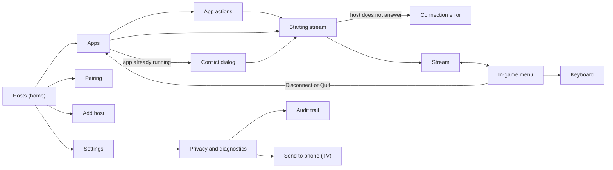

## Screens

### Index

| Screen | Group | Captures |
| --- | --- | --- |
| Hosts | Library | hosts-phone, hosts-tv |
| Add host | Library | none |
| Pairing | Library | pairing-phone |
| Apps | Library | apps-tv |
| App actions | Library | none |
| Starting stream | Starting | starting-phone |
| Conflict dialog | Starting | conflict-phone |
| Connection error | Starting | error-tv |
| Stream | Streaming | stream-phone |
| In-game menu | Streaming | menu-handheld |
| Keyboard | Streaming | keyboard-tv |
| Settings | Settings | settings-tv |
| Privacy and diagnostics | Settings | none |
| Audit trail | Settings | none |
| Send to phone | Settings | send-to-phone-tv |

Each capture shows the first state of its screen, with these exceptions:
`starting-phone` shows the "Host busy (retry)" state at its second step,
`error-tv` shows "Host busy", and `stream-phone` shows the Compact overlay.
On a TV or handheld the focus outline marks the element that has the focus
when the screen opens.

### Hosts

Purpose: the home screen. It shows the session to continue first, then every
known or discovered host with its state and the one action that state allows.

States:

- With hosts (default).
- Searching: no host found yet. The empty screen explains the next step
  ([D8](#decisions)).
- Loading: before the first host report arrives, the screen shows a progress
  indicator and nothing can be focused.

- Touch: tap a host to see its apps. Pair and Wake are inline buttons, so no
  long-press menus are needed.
- D-pad (TV): left rail plus a host grid. Focus starts on Continue. OK opens
  the host; hold OK opens the host options (details, wake, forget).
- Gamepad: as the TV. A opens, X shows the options, B does nothing at the top
  level.

Changes from 12.2: 12.2 hides pairing, wake and details in a long-press
context menu, and has no Continue row.

Decisions: [D2](#decisions), [D8](#decisions).

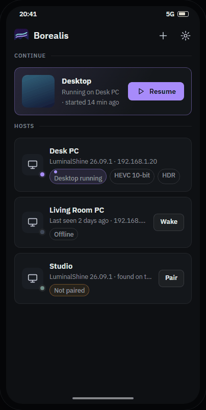

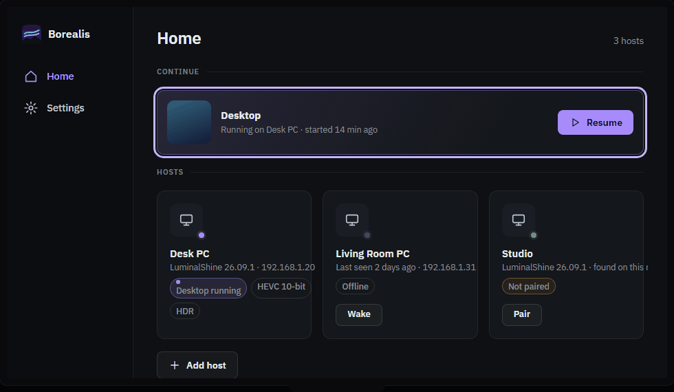

### Add host

Purpose: manual add for hosts that discovery does not find, for example
across VLANs.

States: none.

- Touch: one field; the system keyboard opens at once.
- D-pad (TV): the system TV keyboard opens on OK. The default port needs no
  input.
- Gamepad: as the TV.

Changes from 12.2: the same flow, restyled. No port hint exists today.

Decisions: none.

The address field takes an IP address or a host name. The port is added only
when the LuminalShine port was changed from the default 47989
([host contract, section 2](../host-contract/luminalshine.md)).

### Pairing

Purpose: the PIN is entered on the host, in the LuminalShine Web UI. The
screen says where, keeps the PIN large enough to read from a couch, and covers
the restart and expiry cases that Borealis already handles.

States:

- Waiting for PIN (default).
- New PIN after restart: the host cleared an unfinished attempt and a new PIN
  is shown.
- Paired: the screen closes when the host accepts the PIN.
- Expired: the PIN expired; the user starts again.

- Touch: Cancel only. The screen closes by itself when the host accepts the
  PIN.
- D-pad (TV): the same, with the PIN digits at TV size. Back cancels.
- Gamepad: as the TV.

Changes from 12.2: 12.2 shows the PIN in a small dialog. The Borealis restart
and host-error messages arrive as toasts.

Decisions: none.

The device name must not contain `xbox` or `webos`. The host then holds each
stream start for up to 8 s ([host contract, section 10.2](../host-contract/luminalshine.md)).
The prototype shows this as a step in the pairing text.

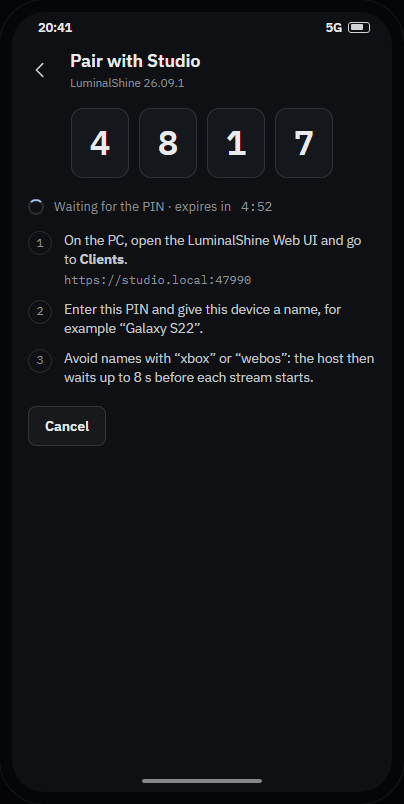

### Apps

Purpose: the apps of one host. The running app is marked and comes first.
Covers are placeholders until the host REST API serves covers by UUID
(Phase 3).

States:

- Desktop running (the first app is marked as running).
- Nothing running.

- Touch: tap starts or resumes the app. The ⋯ button (or long-press) opens the
  app actions.
- D-pad (TV): five columns. OK starts or resumes; hold OK opens the actions.
- Gamepad: four columns. A starts, X opens the actions, B goes back.

Changes from 12.2: the same grid and context menu, restyled, with the running
state visible without opening a menu.

Decisions: [D6](#decisions).

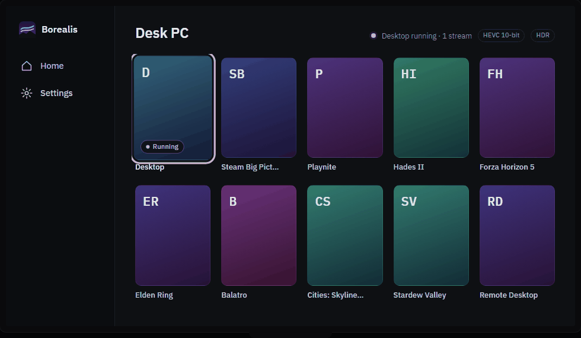

### App actions

Purpose: every action that an app allows in its current state, with the
consequence written under each label.

States:

- Running app: Resume, Quit, Details.
- Other app running: Quit the running app and start this one, Details, Hide
  from this list.

- Touch: bottom sheet.
- D-pad (TV): centered dialog; focus starts on the first action.
- Gamepad: as the TV.

Changes from 12.2: 12.2 shows a context menu with Resume Session, Quit
Session, Quit Current Game and Start.

Decisions: [D6](#decisions).

### Starting stream

Purpose: each stage of starting a stream. The stages include the per-client
virtual display that the host builds for this device and the retries that
Borealis already performs.

States:

- Progress (default): the stages are connecting, starting the app, preparing
  the display, and waiting for the first frame.
- Host busy (retry): another device is starting a stream on this host. The
  screen says that Borealis retries and how many retries are left.

- Touch: Cancel stays available at every step.
- D-pad (TV): Back cancels.
- Gamepad: B cancels.

Changes from 12.2: 12.2 shows one spinner dialog. Sprint 2 added the retry
text to it.

Decisions: none.

The host builds the display for a per-client launch in about 14 s on the
Sprint 2 test host ([host contract, section 7.3](../host-contract/luminalshine.md)).
The screen copy says "up to 15 s" to leave a margin over the measured time.

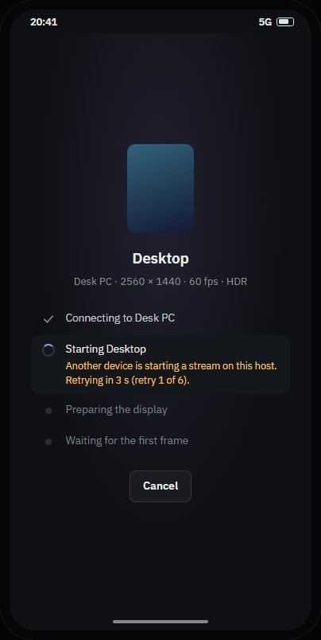

### Conflict dialog

Purpose: another device started an app on this host. Join and Quit and
relaunch are explicit. Cancel has the focus, so a stray OK changes nothing.

States:

- Same app: the running app is the one the user chose.
- Other app: the running app is different. The dialog offers Quit and start.

- Touch: dialog.
- D-pad (TV): focus starts on Cancel.
- Gamepad: focus starts on Cancel; B cancels.

Changes from 12.2: the Sprint 2 dialog, restyled.

Decisions: none.

Quitting ends the stream on the other device. Unsaved work in the app is lost.
See [UC-003](../use-cases/0003-join-or-replace-a-running-app.md).

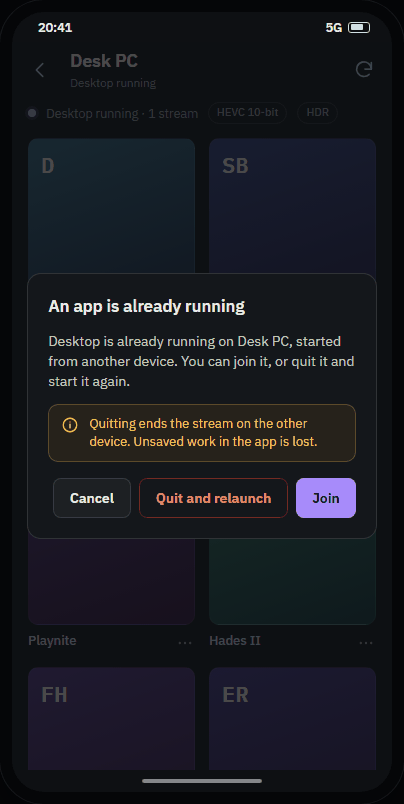

### Connection error

Purpose: errors say what happened and what the host was doing, and offer the
next step. The raw code stays visible for support.

States:

- Host busy: the host did not answer in time. It is probably building a
  display for another device.
- Host offline: the PC is off, asleep, or on another network. The next step
  is Wake PC.
- Certificate changed: the host identity changed since pairing. The next step
  is to pair again. The event is recorded in the audit trail.

- Touch: Try again, the state-specific action, and Diagnostics.
- D-pad (TV): focus starts on Try again.
- Gamepad: as the TV.

Changes from 12.2: 12.2 shows a generic "Connection error" dialog with a code.

Decisions: none.

The Host busy detail line names the attempt count, not a duration: the
Sprint 3 retry makes up to 3 attempts within about 25 s
([host contract, section 7.3](../host-contract/luminalshine.md)).

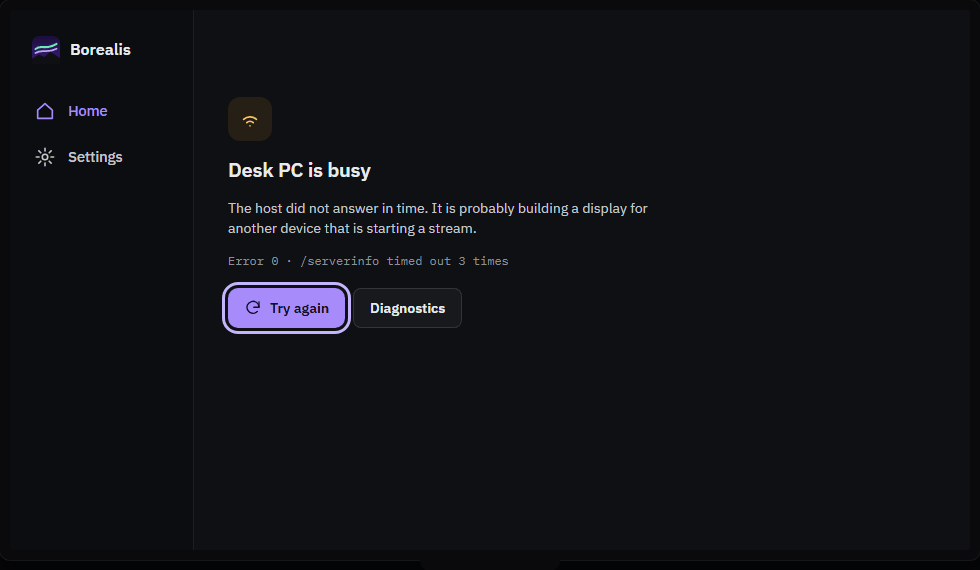

### Stream

Purpose: the picture and, when the user turns it on, the overlay. Nothing else.
The first time, a hint says how to open the menu on this device.

States: none.

- Touch: pull the top handle down, or press Back, to open the menu. A
  three-finger tap opens the keyboard, as in 12.2.
- D-pad (TV): Back opens the menu instead of leaving the stream.
- Gamepad: hold Select + Start for the menu. Every other button goes to the PC.

Changes from 12.2: Back leaves the stream at once. There is no menu.

Decisions: [D3](#decisions), [D4](#decisions), [D5](#decisions).

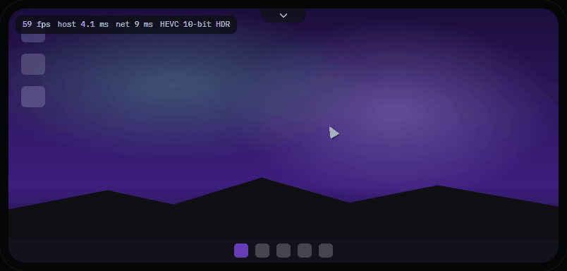

### In-game menu

Purpose: one menu for every device. Session actions are at the bottom and are
separated by intent: Disconnect leaves the app running, Quit ends it.

States: none. The menu items are listed in [In-game menu items](#in-game-menu-items).

- Touch: side panel over the stream; tap outside to close.
- D-pad (TV): focus starts on Back to stream. Back closes the menu.
- Gamepad: B closes the menu.

Changes from 12.2: not in 12.2. Artemis has a dialog-style menu with similar
items.

Decisions: [D3](#decisions), [D5](#decisions), [D6](#decisions).

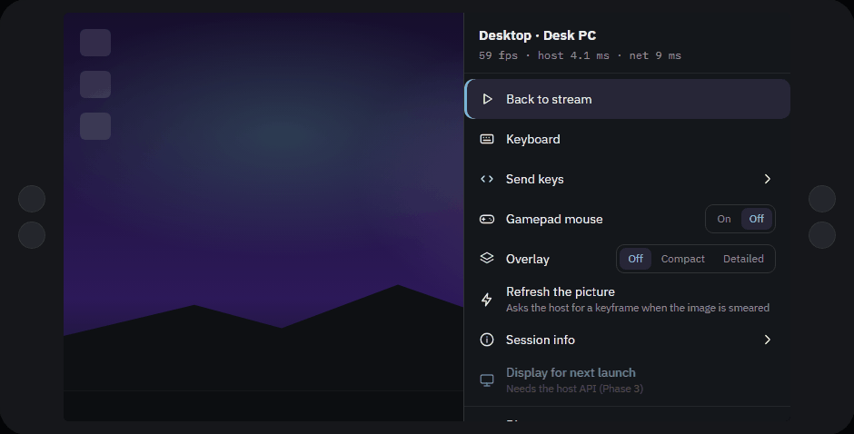

### Keyboard

Purpose: a full keyboard with modifiers that latch, and one row of Windows
shortcuts that are awkward to type. See [In-stream keyboard](#in-stream-keyboard).

States: none.

- Touch: docked at the bottom; the stream stays visible above it.
- D-pad (TV): the D-pad moves across the keys; OK types.
- Gamepad: the D-pad moves, A types, B closes, and Y is Backspace.

Changes from 12.2: 12.2 opens the Android soft keyboard. Android 16 keyboard
capture stays for physical keyboards.

Decisions: none.

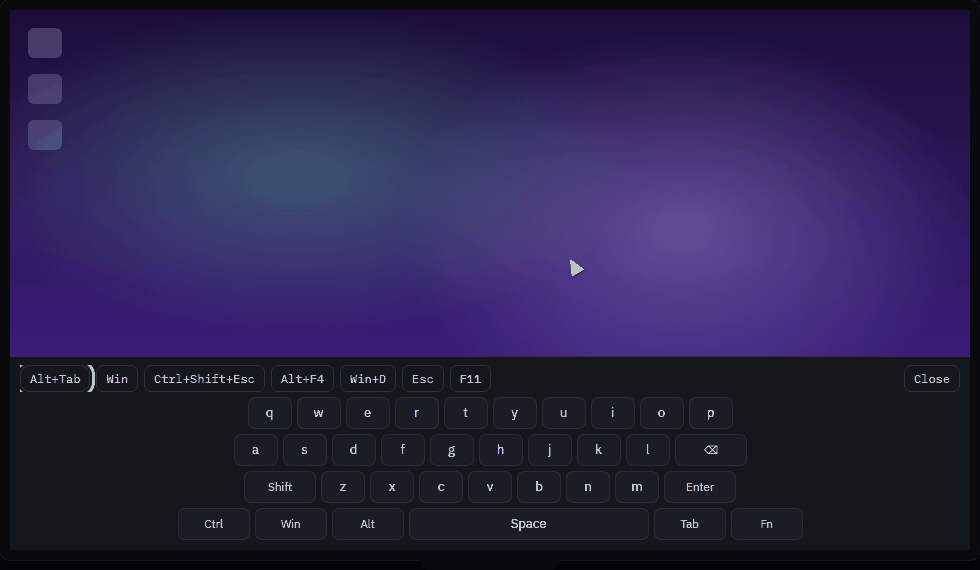

### Settings

Purpose: global settings in five groups (Stream, Video, Input, Audio, About),
plus a link to Privacy and diagnostics. Each row shows its current value.
Per-host overrides come later.

States: none.

- Touch: one list.
- D-pad (TV): two panes. Categories are on the left and items on the right.
- Gamepad: as the TV.

Changes from 12.2: one long preference screen, plus a separate Borealis
screen.

Decisions: [D7](#decisions).

The groups and their rows are listed in [Settings groups](#settings-groups).

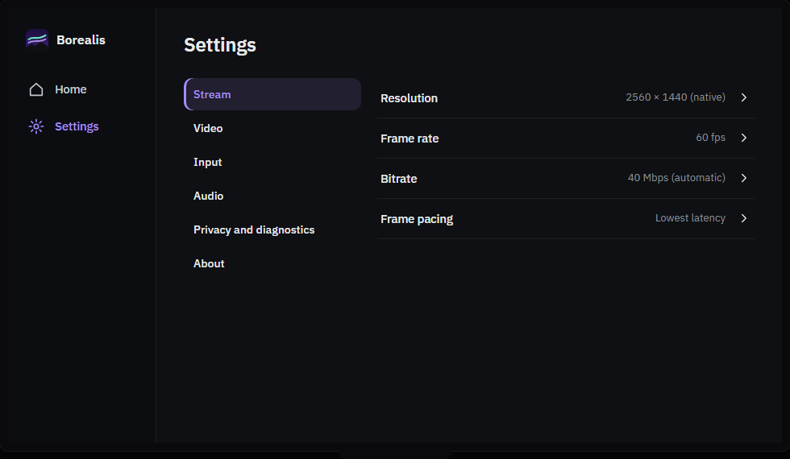

### Privacy and diagnostics

Purpose: everything about logs and diagnostics in one place, including the
audit trail viewer that the Phase 2 UI adds.

States: none.

- Touch: Export shares the bundle.
- D-pad (TV): Export saves the bundle and offers Send to phone.
- Gamepad: as the TV.

Changes from 12.2: a Sprint 2 interim screen.

Decisions: none.

Rows: Verbose logging, Mask addresses in logs and diagnostics, export diagnostic
bundle, audit trail, and erase audit trail. The erase row says that it cannot
be undone. See [privacy and logging](../policies/privacy-and-logging.md).

### Audit trail

Purpose: security-relevant events, newest first, in plain words with the event
code for support.

States: none.

- Touch: scrolls; tap an entry for its detail.
- D-pad (TV): D-pad scrolls entry by entry.
- Gamepad: as the TV.

Changes from 12.2: only inside the exported bundle (Sprint 2).

Decisions: none.

The event codes are listed in [Audit event names](#audit-event-names). The
retention is the newest 2,000 entries or 90 days, whichever is smaller
([privacy and logging](../policies/privacy-and-logging.md#audit-trail)).

### Send to phone

Purpose: the Sprint 3 transfer. It is a one-download link on the local
network, shown as a QR code, and it closes after the download or after
5 minutes.

States:

- Waiting: the link is open and the countdown runs.
- Downloaded: the link is closed.
- Expired: the link expired; the user opens Send to phone again.
- No local network: a phone cannot reach the TV. The dialog shows the adb
  command instead.

- Touch: not offered on phones. Phones share instead.
- D-pad (TV): Close has the focus. Closing the dialog stops the link.
- Gamepad: as the TV.

Changes from 12.2: adb pull only.

Decisions: none.

The phone and the TV must be on the same network. The link works for one
download. See [UC-006](../use-cases/0006-send-diagnostics-from-a-tv-to-a-phone.md).

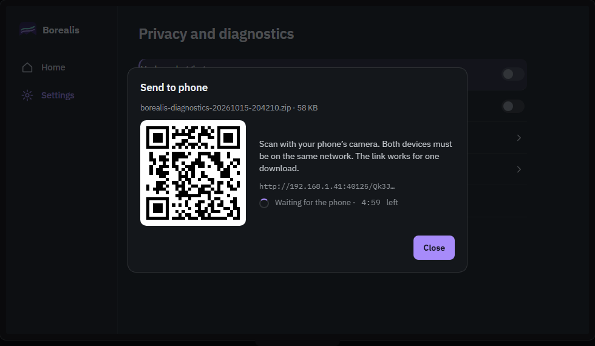

## In-stream details

### In-game menu items

The menu lists these items, in this order. Items that the prototype shows as
disabled are marked.

1. Back to stream. Closes the menu.
2. Keyboard. Opens the [keyboard](#keyboard).
3. Send keys. Expands a row of chips: Alt+Tab, Win, Ctrl+Shift+Esc, Alt+F4,
   Win+D, Win+G, Esc, Win+Alt+B.
4. Touch (phone) or Gamepad mouse (TV and handheld). On a phone the choices
   are Trackpad, Direct and Off. On a TV or handheld the choices are On and
   Off.
5. Overlay: Off, Compact or Detailed. The approved default is Off
   ([D5](#decisions)).
6. Refresh the picture. Asks the host for a keyframe when the image is
   smeared.
7. Session info. Expands to the video, codec, decoder, host and network
   figures, and the bitrate against its limit.
8. Display for next launch. Disabled: it needs the host API (Phase 3).
9. Disconnect. Describes the consequence: the app keeps running on the PC.
10. Quit and the app name. Ends the app on the PC. This row is shown in the
    danger style.

### In-stream keyboard

- A shortcut row: Alt+Tab, Win, Ctrl+Shift+Esc, Alt+F4, Win+D, Esc, F11 and
  Close.
- Three letter rows. The first is Q to P. The second is A to L and ends with
  Backspace. The third starts with Shift, has Z to M, and ends with Enter.
- A bottom row: Ctrl, Win, Alt, Space, Tab and Fn.
- Ctrl, Alt, Win and Shift latch. The next typed key is sent with them, and
  the latch is cleared.

### Overlay contents

Compact (one line of four figures):

- frames per second;
- host processing time in ms;
- network time in ms;
- the codec, for example HEVC 10-bit HDR.

Detailed:

- resolution, frame rate (cap), codec and HDR format;
- the decoder name;
- host processing time as minimum, average and maximum in ms;
- network time in ms with the jitter, the loss in percent and the bitrate in
  Mbps;
- decode time and render queue time in ms.

The prototype's figures are examples. The overlay is off by default
([D5](#decisions)).

### Settings groups

| Group | Rows |
| --- | --- |
| Stream | Resolution, Frame rate, Bitrate, Frame pacing |
| Video | Codec, HDR, Full range, Performance overlay |
| Input | Touch, Mouse back and forward buttons, Gamepad mouse, Deadzone |
| Audio | Channels, Play audio on the PC |
| Privacy and diagnostics (link, not a group) | Opens the Privacy and diagnostics screen |
| About | Borealis version and commit, Source code, Open-source licences |

The prototype fills the rows with example values, not defaults. Phase 2 keeps
the current defaults: 1280 x 720, 60 fps, automatic bitrate, lowest-latency
frame pacing, automatic codec, HDR off, full range off, overlay off,
trackpad on, stereo audio, audio on the PC off, Verbose logging off and
Mask addresses in logs and diagnostics off.

### Audit event names

The audit trail uses these event names. The privacy policy lists the events
and their fields ([privacy and logging](../policies/privacy-and-logging.md#audit-trail)).

- Pairing: PAIRING_START, PAIRING_SUCCESS, PAIRING_FAILURE, PAIRING_RESTART.
- Unpairing: UNPAIR_CONFIRMED, UNPAIR_NOT_CONFIRMED.
- Host identity and TLS: CERTIFICATE_CHANGED, TLS_FAILURE.
- Launch: LAUNCH_ATTEMPT, LAUNCH_RETRY, LAUNCH_CONFLICT.
- Session: SESSION_START, SESSION_END.

The prototype shows these example rows, with example hosts:

| Time | Entry | Event code |
| --- | --- | --- |
| 20:42 | Stream ended | SESSION_END |
| 20:34 | Stream started | SESSION_START |
| 20:33 | Host asked to retry | LAUNCH_RETRY |
| 20:33 | App started | LAUNCH_ATTEMPT |
| 18:02 | Paired | PAIRING_SUCCESS |
| 18:01 | Pairing restarted | PAIRING_RESTART |
| 18:00 | Pairing started | PAIRING_START |
| Mon | Host certificate changed | CERTIFICATE_CHANGED |

No entry records a PIN, a token or a key ([privacy and logging](../policies/privacy-and-logging.md)).

## Decisions

ADR [0052](../adr/0052-structure-the-phase-2-ui.md) records the eight choices.
The owner approved the first option of each decision on 2026-10-15.

| ID | Decision | Chosen option |
| --- | --- | --- |
| D1 | Light theme | Dark only for 1.0 |
| D2 | Home | Hosts, with a Continue row on top |
| D3 | Opening the in-game menu | Back opens the menu; top handle on touch; Select + Start held on gamepads |
| D4 | Default touch mode | Trackpad (relative), as today |
| D5 | Performance overlay | Off, one tap away in the menu (Compact or Detailed) |
| D6 | Leaving a session | "Disconnect" and "`Quit <app>`", each with a one-line consequence |
| D7 | Settings scope | Global now; per-host overrides later |
| D8 | First run | No onboarding; the empty Hosts screen explains the next step |

The options that were not chosen, with their pros and cons, are in ADR 0052.

## Visual language

### Tokens

The tokens come from the LuminalShine Mission Control web UI. The gold accent
family is replaced by violet. [design/tokens.json](../../design/tokens.json)
is the source. The dark palette:

| Token | Value | Use |
| --- | --- | --- |
| page | #0E1013 | Screen background |
| chrome | #0B0D10 | Navigation rail and bars |
| surface | #14171B | Cards, sheets, dialogs, side panels |
| surface-raised | #1A1E24 | Keys, popovers, elements on a surface |
| ink | #E8EAED | Primary text |
| ink-2 | #C3C7CC | Secondary text |
| ink-3 | #8B9096 | Tertiary text and metadata |
| ink-4 | #7A8087 | Hints and kickers |
| accent | #A78BFA | Primary actions, links, selection |
| accent-soft | #C4B5FD | Focus outline on TV and gamepad |
| accent-strong | #7C3AED | Borders and fills that carry no text |
| on-accent | #160B2E | Text and icons on accent fills |
| success-ink | #7BD389 | Success text |
| warning-ink | #FFC857 | Warning text |
| danger-ink | #FF8A80 | Danger text and destructive actions |

Status colours (success #4CAF50, warning #FFA726, danger #F44336) are reserved
for state. They are never decorative.

### Changes from Mission Control

- `ink-4` is #7A8087 instead of #6F757C. The old value gives 4.09:1 on page
  and 3.86:1 on surface (computed), which fails 4.5:1 for hint text. The new
  value gives 4.78:1 on page and 4.51:1 on surface.
- On `surface-raised`, use `ink-3`, not `ink-4`.

### Contrast

Dark palette, WCAG 2.x, computed:

| Pair | Ratio | Use |
| --- | --- | --- |
| ink on page | 15.81 | Body text |
| ink-2 on surface | 10.58 | Secondary text |
| ink-3 on surface | 5.59 | Tertiary text |
| ink-4 on page | 4.78 | Hints |
| ink-4 on surface | 4.51 | Hints |
| accent on page | 7.00 | Accent text and links |
| accent on surface | 6.61 | Accent text on surfaces |
| on-accent on accent | 6.88 | Text on accent fills |
| accent-soft on page | 10.32 | Focus outline and accent text on dark overlays |
| accent-strong on page | 3.34 | Borders and fills without text only |
| success-ink on surface | 9.86 | Success text |
| warning-ink on surface | 11.69 | Warning text |
| danger-ink on surface | 7.88 | Danger text |

### Type

- Typefaces: IBM Plex Sans for the UI; IBM Plex Mono for data, codes,
  addresses and PIN digits.
- Phone scale: title 18sp semibold; body 14sp; secondary 12.5sp; kicker 11sp,
  uppercase, letter spacing 0.07em; PIN 34sp monospace.
- TV scale: title 24sp semibold; body 15sp; navigation rail 14.5sp medium. No
  text is smaller than 12sp on a TV.

### Radii and spacing

- Radii: card 12dp; button 8dp; input 8dp; cover 10dp; chip 7dp; bottom sheet
  18dp at the top corners; pill 999dp.
- Spacing: a 4dp base unit. Screen gutter 16dp on phones and 34dp on TVs.
  Card padding 14dp on phones and 18dp on TVs.

## Phase 3 extension points

Phase 3 adds REST features. The prototype shows some of them as disabled
items or placeholders. The host endpoints are in
[host contract, section 17.2](../host-contract/luminalshine.md#172-endpoints-relevant-to-a-client).

- App covers by UUID: `GET /api/apps/{uuid}/cover`. The Apps screen shows
  placeholder covers until then.
- Closing an app: `POST /api/apps/close`. Not shown as a placeholder in the
  prototype, which shows only the Quit copy. Until Phase 3, Quit uses the
  GameStream `/cancel` request, as Moonlight 12.2 does.
- Display for next launch: per-client display settings. The menu row is
  disabled in the prototype, with the note "Needs the host API (Phase 3)".
- Session telemetry: `GET /api/sessions`. Not shown as a placeholder in the
  prototype.

## Next steps

1. Implement the acceptance tests of [UC-001](../use-cases/0001-pair-with-a-host.md)
   to [UC-008](../use-cases/0008-add-a-host-by-address.md) first
   ([TDD](../development/tdd.md)). The use cases are written now.
2. Build the Phase 2 screens in Compose, one screen at a time, with
   Roborazzi screenshots for the states above ([ADR 0034](../adr/0034-screenshot-testing-with-roborazzi.md)).
3. Generate the Kotlin tokens from `design/tokens.json` through the token
   pipeline ([ADR 0044](../adr/0044-design-tokens-pipeline.md)).

## How to open the prototype

1. Open [prototype.html](prototype.html) in a browser.
2. Use the Device switch (Phone, TV, Handheld) to change the input mode. The
   choice is kept in the browser.
3. Use the App theme switch (Dark, Light). Light is shown for review only;
   1.0 is dark only ([D1](#decisions)).
4. Select a screen in the index, or open a deep link.
5. In the TV and Handheld modes, use the arrow keys, Enter and Esc. Shift +
   Enter holds OK. In the Handheld mode, Q holds Select + Start.

Deep links take the form `#<screen>.<mode>[.<state>[.<step>]]`, for example
`#menu.tv` for the in-game menu on a TV, or `#pair.phone.1` for the New PIN
state of the pairing screen. The states are numbered from 0 in the order
listed in the Screens section.

The prototype uses example data only: host names, addresses, apps and session
figures are illustrative.

The prototype loads IBM Plex from Google Fonts, so opening it contacts Google's
font servers. The app itself will bundle its fonts.
